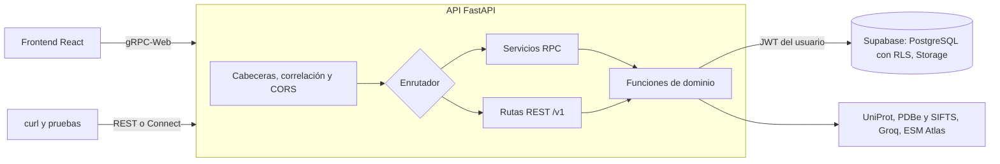

# ProteinForge — API

API de ProteinForge, un banco de trabajo web para analizar, comparar y diseñar secuencias de proteínas. Este repositorio contiene la API que autentica a las personas, guarda sus proyectos en Supabase, consulta servicios públicos (UniProt, PDBe/SIFTS) y ofrece, de forma opcional, una lectura en prosa de resultados y la predicción de estructuras. El cálculo científico ocurre en el navegador: ver el [frontend](https://github.com/Jacklb19/ProteinForge).

- API en producción: <https://protein-back.vercel.app/v1/health>
- Aplicación web: <https://protein-forge.vercel.app>

## Stack

| Área | Tecnología |
|---|---|
| Lenguaje y framework | Python 3.14, FastAPI 0.16x, Uvicorn |
| RPC | Connect RPC (`connectrpc`): Connect, gRPC y gRPC-Web; contratos Protocol Buffers con buf |
| HTTP | httpx 0.28, `pyqwest` |
| Identidad y datos | Supabase: Auth, PostgreSQL con RLS, PostgREST y Storage |
| Asistente de interpretación | Groq con `openai/gpt-oss-120b` (opcional) |
| Calidad | unittest, coverage (mínimo del 70 %), ruff, buf y `pip-audit` |

Las versiones exactas están en `requirements.in` (directas) y `requirements.txt` (compilado con hashes).

## Arquitectura



Los transportes REST y RPC comparten las mismas funciones de dominio, validación y autorización. La API valida el token de Supabase Auth y reenvía ese mismo JWT a PostgREST, de modo que las políticas RLS de PostgreSQL deciden qué filas se ven; la API nunca usa la clave `service_role`. Más detalle en [arquitectura](docs/arquitectura.md).

## Endpoints principales

Prefijo `/v1`. Todo, salvo la salud y la lectura de enlaces compartidos, exige un token de Supabase Auth.

| Ruta | Propósito |
|---|---|
| `GET /health`, `GET /me` | Estado del servicio e identidad |
| `/projects` | Proyectos (CRUD), versiones y enlaces de solo lectura |
| `GET /uniprot/search`, `GET /uniprot/{accession}` | Referencias de UniProt |
| `GET /pdb/{pdbId}/residue-mapping` | Correspondencia SIFTS entre UniProt y PDB |
| `POST /assistant/interpret` | Lectura en prosa de resultados |
| `POST /predictions/fold` | Predicción de estructura (opcional) |
| `/reports` | Informes en Storage |
| `GET /live` | WebSocket de avisos de cambios (opcional) |

Los mismos servicios están disponibles como `proteinforge.<paquete>.v1.<Servicio>/<Método>`. Contratos completos en [API](docs/api.md).

## Estructura de carpetas

```text
app/                   # aplicación FastAPI: dominio, configuración y middleware
├── rpc/               # servicios y enrutador RPC; gen/ es código generado por buf
proto/                 # contratos Protocol Buffers
supabase/migrations/   # esquema, funciones y políticas RLS de PostgreSQL
tests/                 # pruebas de API, RPC, migraciones y SQL
scripts/               # utilidades: pruebas SQL, carga local, comprobación de despliegue y diagnóstico
docs/                  # documentación técnica
```

## Puesta en marcha

Requisitos: Python 3.14, y para las pruebas SQL, PostgreSQL 18. Desde la raíz del repositorio:

```bash
python -m venv .venv
# Windows
.venv/Scripts/python -m pip install --require-hashes -r requirements-dev.txt
.venv/Scripts/python -m uvicorn app.main:app --reload
# Linux y macOS
.venv/bin/python -m pip install --require-hashes -r requirements-dev.txt
.venv/bin/python -m uvicorn app.main:app --reload
```

(`requirements.txt` instala solo lo necesario para ejecutar la API; `requirements-dev.txt` añade las herramientas de desarrollo.) Copiar `.env.example` a `.env` y completar las variables; la aplicación lee el `.env` de la raíz del repositorio, y las variables del proceso tienen prioridad. `GET /v1/health` responde sin configuración; `GET /v1/me` necesita `SUPABASE_URL`, `SUPABASE_ANON_KEY` y un token Bearer de Supabase Auth. `localhost` y `127.0.0.1` son orígenes distintos para CORS: `ALLOWED_ORIGINS` debe contener el exacto que usa el navegador, con puerto.

### Variables de entorno

Los nombres sin valores están en `.env.example`. Nunca se versiona `.env` ni una clave `service_role`.

| Variable | Valor por omisión | Efecto |
|---|---|---|
| `SUPABASE_URL`, `SUPABASE_ANON_KEY` | — | Proyecto de Supabase y su clave pública. Sin ellas no hay identidad (503) |
| `ALLOWED_ORIGINS` / `FRONTEND_ORIGIN` | — | Orígenes CORS permitidos (lista separada por comas, o uno solo) |
| `SHARED_BUDGET_ENABLED` | apagada | `enabled` cuenta los presupuestos por cuenta en PostgreSQL, compartidos entre instancias |
| `UNIPROT_REQUESTS_PER_MINUTE` | 20 | Consultas a UniProt por cuenta y minuto (0 las desactiva) |
| `GROQ_API_KEY` | — | Activa el asistente; sin ella la ruta responde 503 |
| `ASSISTANT_MODEL` | `openai/gpt-oss-120b` | Modelo de Groq |
| `ASSISTANT_REQUESTS_PER_MINUTE` | 6 | Lecturas por cuenta y minuto (0 las desactiva) |
| `ASSISTANT_REQUESTS_PER_DAY` | 0 | Lecturas diarias de todas las cuentas juntas (0, sin tope) |
| `ASSISTANT_CACHE_TTL_SECONDS`, `ASSISTANT_CACHE_MAX_ENTRIES` | 300, 256 | Caché de lecturas verificadas (0 la desactiva) |
| `FOLDING_ENABLED` | apagada | `enabled` activa la predicción con ESM Atlas |
| `API_DOCS_ENABLED` | apagada | `enabled` sirve `/docs`, `/redoc` y `/openapi.json`; vacío en producción |
| `LIVE_ENABLED` | apagada | `enabled` sirve el WebSocket `/v1/live` |
| `LIVE_POLL_SECONDS`, `LIVE_MAX_CONNECTION_SECONDS` | 5, 240 | Frecuencia de lectura y duración máxima de cada conexión |
| `SHARED_REQUESTS_PER_MINUTE` | 30 | Lecturas de enlaces compartidos por dirección y minuto, por proceso (0 las desactiva) |

## Migraciones

`supabase/migrations/` contiene el esquema, las funciones `pf_*` y las políticas RLS, y se aplican en orden de nombre sobre el proyecto de Supabase con la CLI o con `psql` (cada migración es idempotente). La lista y su contenido están en [persistencia de proyectos](docs/project-persistence.md#migraciones). Cuando un cambio afecta al contrato, el orden de despliegue es migración → API → frontend.

## Pruebas

```bash
.venv/Scripts/python -m unittest discover -s tests    # Linux y macOS: .venv/bin/python
.venv/Scripts/ruff check .
```

- `unittest` cubre REST y RPC por los tres protocolos, la identidad, los proyectos, los servicios externos con transporte simulado y la revisión estática de las migraciones. Las pruebas SQL se omiten si no hay una base configurada.
- Pruebas SQL (migraciones, RLS y concurrencia) con PostgreSQL 18 real. En Windows, `scripts/test-postgres.ps1` crea un clúster temporal en loopback. En otros sistemas, se levanta un PostgreSQL 18 con una base `pf_security_test` accesible en loopback, se aplica `tests/postgres_bootstrap.sql` y después todas las migraciones, y se definen `PF_TEST_DATABASE_URL` (por ejemplo `postgresql://postgres@127.0.0.1:5432/pf_security_test`) y `PF_PSQL` (`psql`) antes de ejecutar `unittest`; el flujo de CI hace exactamente eso con un servicio de contenedor.
- Cobertura: `python -m coverage run -m unittest discover -s tests` y `python -m coverage report` (mínimo del 70 %).
- Contratos: `buf lint` y regeneración con la versión de buf fijada en CI (1.75.0); `app/rpc/gen/` debe coincidir con la salida. Ver [API](docs/api.md#código-generado).
- Carga local: [carga sostenida](docs/carga-local.md).

## CI y despliegue

- CI (`.github/workflows/ci.yml`): instala dependencias con hashes, comprueba que los archivos compilados coinciden con sus `.in`, audita las dependencias, ejecuta ruff, buf, las migraciones sobre PostgreSQL 18 y la batería con cobertura. `deployment-check.yml` comprueba el despliegue cada seis horas.
- Despliegue en Vercel con el preset FastAPI, la raíz del repositorio como raíz del proyecto y `app/main.py:app` como aplicación; `.python-version` fija Python 3.14. Vercel instala `requirements.txt`; por eso el repositorio no tiene `pyproject.toml`, que Vercel tomaría como manifiesto de dependencias. Las variables mínimas son `SUPABASE_URL`, `SUPABASE_ANON_KEY` y `ALLOWED_ORIGINS`. Guía completa en [despliegue](https://github.com/Jacklb19/ProteinForge/blob/main/docs/despliegue.md).

## Documentación

[Arquitectura](docs/arquitectura.md) · [API](docs/api.md) · [Proyectos](docs/project-persistence.md) · [Historial del generador](docs/generator-history.md) · [UniProt](docs/uniprot.md) · [SIFTS](docs/sifts.md) · [Asistente](docs/assistant.md) · [Predicción](docs/folding.md) · [Canal en vivo](docs/live.md) · [Carga local](docs/carga-local.md)

## Repositorio relacionado

El [frontend](https://github.com/Jacklb19/ProteinForge) (React, Workers y WebAssembly) consume los contratos de `proto/` mediante clientes generados que fija a un commit de este repositorio.

## Licencia

MIT. Ver [LICENSE](LICENSE).
