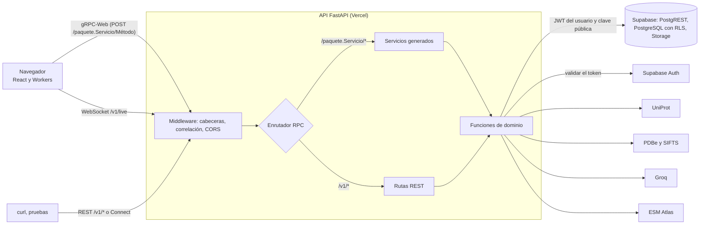

# Arquitectura del backend

La API de ProteinForge es una aplicación FastAPI que expone los mismos casos de uso por REST y por RPC (Connect, gRPC y gRPC-Web). Gestiona la identidad, la autorización por recurso, los proyectos, la consulta acotada de servicios públicos (UniProt, PDBe/SIFTS, ESM Atlas), la interpretación de resultados con Groq y los informes. No ejecuta algoritmos científicos: el cálculo, la generación de candidatos y la visualización ocurren en el navegador (repositorio [ProteinForge](https://github.com/Jacklb19/ProteinForge)).

## Vista general

## Capas

| Capa | Código | Responsabilidad |
|---|---|---|
| Transporte | `app/main.py`, `app/rpc/` | Fábrica de la aplicación; middleware de cabeceras de seguridad, correlación (`X-Request-Id`) y CORS; un enrutador ASGI envía `/<paquete>.<Servicio>/*` a los servicios generados y el resto a REST |
| Contratos | `proto/`, `app/rpc/gen/` | Los `.proto` son la fuente; el código Python se genera con buf y se versiona |
| Dominio | `app/projects.py`, `reports.py`, `uniprot.py`, `sifts.py`, `residue_mapping.py`, `assistant.py`, `folding.py`, `shares.py`, `live.py` | Validación (Pydantic), reglas y llamadas a los proveedores; una única implementación para REST y RPC |
| Identidad | `app/identity.py` | Valida el token consultando a Supabase Auth y exige `aal2` a las cuentas con un segundo factor verificado |
| Configuración | `app/config.py` y los `*_config.py` por dominio | Variables de entorno, límites y constantes con nombre; ningún valor fijo en el dominio |
| Datos | `supabase/migrations/` | Esquema, funciones `pf_*`, políticas RLS y grants, aplicados en orden de nombre |

## Datos y autorización

- La API **nunca usa la clave `service_role`**. Cada petición a PostgREST y a Storage lleva la clave pública en `apikey` y el token del usuario en `Authorization`, de modo que las políticas RLS deciden qué filas se ven o se escriben.
- Las tablas de usuario (`profiles`, `projects`, `analyses`, `alignments`, `reports`, `project_versions`, `project_shares`) tienen RLS; `external_cache` y `spend_windows` no tienen políticas y solo las funciones `SECURITY DEFINER` acceden a ellas. Todas las funciones `SECURITY DEFINER` fijan `search_path` vacío, y los permisos de `anon` y `public` se revocan de forma explícita.
- Las funciones de proyectos (`pf_save_project`, `pf_delete_project`, `pf_list_projects`…) son `SECURITY INVOKER`: escriben con los permisos de quien llama.
- La concurrencia es optimista: PUT y DELETE llevan la marca de tiempo completa (con microsegundos), la comprobación se hace bajo bloqueo y un conflicto responde 409. Una guardia monótona impide que un cliente antiguo sobrescriba una instantánea de versión superior ([proyectos](project-persistence.md)).
- Una variante opt-in de MFA en RLS exige `aal2` solo a las cuentas con un factor verificado ([API](api.md#mfa-en-rls)).
- El presupuesto de consultas a los proveedores es por cuenta; puede contarse en PostgreSQL (`SHARED_BUDGET_ENABLED`) para compartirlo entre instancias.

## Proveedores externos

| Proveedor | Para qué | Cómo se acota |
|---|---|---|
| UniProt | Búsqueda y ficha de referencias | Destino fijo `rest.uniprot.org`, tiempo máximo de 12 s, respuesta de hasta 8 MB, presupuesto por cuenta ([UniProt](uniprot.md)) |
| PDBe y SIFTS | Correspondencia residuo a residuo UniProt-PDB | URL fijas, sin redirecciones, descarga en bloques acotados y caché pública en memoria ([SIFTS](sifts.md)) |
| Groq | Lectura en prosa de resultados ya calculados | Clave solo en el servidor; no recibe la secuencia; verificación de cifras ([asistente](assistant.md)) |
| ESM Atlas | Predicción de estructura (opcional) | Consentimiento por solicitud, límites por cuenta y por proceso, validación del PDB ([predicción](folding.md)) |
| Supabase Storage | Informes | La API firma las URL; el navegador sube y descarga directamente |

Los secretos viven solo en variables del servidor. No se registran secuencias privadas ni secretos en los logs, y los errores nunca incluyen datos enviados por la persona.

## Despliegue

- Un proyecto de Vercel con el preset FastAPI y la raíz del repositorio como raíz del proyecto: detecta `app/main.py:app`, instala `requirements.txt` y usa la versión de Python de `.python-version` (3.14).
- Las dependencias directas están en `requirements.in` y se compilan con hashes (`uv pip compile`) en `requirements.txt`; CI comprueba que coinciden y ejecuta `pip-audit`. El repositorio no tiene `pyproject.toml` a propósito, porque Vercel lo tomaría como manifiesto de dependencias en lugar de `requirements.txt`.
- La API no instala modelos ni pesos: la predicción usa un servicio público externo y el modelado del laboratorio ocurre en un cuaderno de Colab.
- Orden de publicación cuando cambia un contrato: migración en Supabase → backend → actualizar el pin de `buf.gen.yaml` del frontend y regenerar → frontend. Las variables y las URL están en la [guía de despliegue](https://github.com/Jacklb19/ProteinForge/blob/main/docs/despliegue.md).

## Pruebas y CI

`python -m unittest discover -s tests` cubre la auditoría estática, REST, RPC por los tres protocolos, proyectos, adaptadores con transporte simulado y los servicios SIFTS, asistente, informes, canal en vivo y predicción. Las pruebas SQL ejecutan las migraciones, RLS y la concurrencia contra un PostgreSQL real con `auth.uid()` emulado (`tests/postgres_bootstrap.sql`): `scripts/test-postgres.ps1` en local y un servicio PostgreSQL 18 en CI. No sustituyen la comprobación contra PostgREST y Supabase reales. CI ejecuta además ruff, `buf lint`, la comprobación de que el código generado está al día y un umbral de cobertura. Un flujo programado (`deployment-check.yml`) comprueba el despliegue.
